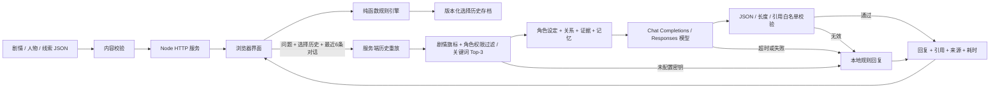

# 技术架构

## 运行边界

## 关键设计

1. `story.js` 同时运行在浏览器和 Node，不依赖 DOM 或网络。`choose` 克隆状态后应用白名单效果，先检查条件再跳转，避免选项失败后发生部分写入。
2. 服务端不接受客户端传来的旗标、节点或关系值。`history` 从初始状态重放，只有合法的选项序列能形成对话上下文。重放不证明客户端实际游玩过；单机项目没有账号与签名存档。
3. 检索先按 `requiresFlag` 与 `characters` 过滤，再按命中的关键词长度累加分数。仅注入最多 3 条匹配线索，未知问题不填充随机事实。
4. 系统规则与证据独立于用户问题；记忆只接受 `user` / `assistant`，最多 6 条，每条最多 600 字。历史记忆也是不可信内容，不能作为新增事实来源。
5. 生成结果仅保留 `reply`、`evidenceIds`、`uncertain`。非空证据必须有引用；引用必须来自当次检索。回复不能调用规则引擎，没有状态更新工具。
6. 模型请求默认 12 秒超时，本机 Codex 配置使用 60 秒；前端从健康检查读取时限并额外预留 3 秒（最少等待 18 秒）。每来源每分钟最多 20 次对话，同时最多 4 个处理中的请求，请求体最多 16 KiB。不做自动重试，避免供应商异常时反复扣费。
7. HTTP 静态文件使用白名单，仅发布表现层、纯规则模块与美术文件。密钥、服务端源码不在发布目录。响应设置 CSP、nosniff 与 same-origin Referrer Policy；对话请求检查 Origin。
8. 前端使用 `textContent` 和 DOM 元素构建显示，模型回复不会当作 HTML。推进剧情、切换人物或导入存档时取消旧请求，并用会话版本防止旧回复写入新场景。
9. `AI_WIRE_API` 选择协议。Responses 把规则与证据放入 `instructions`，历史和问题放入 `input`，禁用服务端响应存储，使用 `text.format` 请求 JSON。仅接受完成状态并从 assistant 的 `output_text` 提取结果；后续引用校验与 Chat 分支复用。

## 状态与存档

运行状态包含 `nodeId / flags / relationships / history / visited`；存档只保存 `version / storyId / history`。读档时由引擎重放，拒绝未知选项、不满足条件的跳转、超过 64 步的历史和不兼容版本。导入失败时保留当前状态。

自动存档和结局收藏使用浏览器 localStorage，导出为 JSON。当前版本不保存聊天、API Key 或用户账号信息。更改已有选择 ID 或效果可能导致旧档无法重放，应修改存档版本并设计迁移。

## AI 能力的真实边界

- 这是检索增强生成的一种小规模实现，检索为关键词匹配。当前没有 embedding、向量索引或 reranker。
- 角色记忆是有限窗口，不是长期记忆；关系值仅影响表达风格。对话不会获得道具、增加信任或解锁结局。
- JSON 与引用校验属于结构检查，无法自动验证事实是否真的由引用支持。真实模型仍需人工检查事实一致性、人物一致性、未知回答与注入对抗。
- 本地评测与 mock 测试不产生真实模型质量指标。没有 API Key 时，UI 明确展示本地规则模式。
- 全量剧情由 `/api/content` 提供，用户可以在开发工具中查看。本项目不试图隐藏客户端故事源文件。

## 后续扩展触发条件

角色知识扩展到数百段、关键词召回不足时再评估混合检索；多用户上线时再补账号、数据库存档、集中限流与费用配额。当前不为作品集演示引入额外服务依赖。
